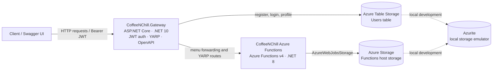

# CoffeeNChill — CLDV6212 Part 3

CoffeeNChill is a cloud-oriented coffee shop API project for the CLDV6212 Part 3 university assignment. The repository currently contains a .NET 10 API Gateway that handles customer authentication, issues and validates JWTs, and routes requests toward a .NET 8 Azure Functions backend. Azure Table Storage is used for gateway user accounts; the Compose configurations include Azurite for local storage emulation.

> **Repository scope:** In the checked-in tree, the Functions source directory referenced by the solution and `Dockerfile` (`CoffeeNChill/`) is absent. Consequently, this README documents only backend routes explicitly visible in gateway configuration and does not claim details about function implementations, data models, or business behavior that are not present here.

## Project links

- **Live API:** [https://34-63-96-50.sslip.io/](https://34-63-96-50.sslip.io/)
- **Swagger UI:** [https://34-63-96-50.sslip.io/swagger](https://34-63-96-50.sslip.io/swagger)
- **Docker Hub account:** [disantejade154362](https://hub.docker.com/u/disantejade154362)
- **Demonstration video:** _[Add the demonstration video link here]_ 

## Architecture



The gateway is the client-facing entry point. Its explicit menu handlers forward GET requests to the configured Functions destination; its YARP routes also send matching requests to the configured coffee cluster. The gateway initializes the `Users` Table Storage table on startup. In local Compose environments, Azurite provides storage services in place of Azure Storage.

## Technology and components

| Component | Implementation evidenced in the repository |
| --- | --- |
| API Gateway | ASP.NET Core minimal APIs, targeting `net10.0` |
| Reverse proxy | YARP (`Yarp.ReverseProxy`), routes and destinations configured in `CoffeeNChill.Gateway/appsettings.json` |
| Authentication | JWT Bearer validation; HMAC-SHA256 signed tokens with issuer, audience, signature, and lifetime validation |
| User persistence | Azure.Data.Tables; `UserTableService` stores account entities in the `Users` table |
| Password storage | ASP.NET Core `PasswordHasher<UserEntity>`; passwords are stored as hashes |
| Functions backend | Azure Functions v4, .NET 8 in-process, as configured by `Dockerfile` |
| API documentation | Swagger / Swashbuckle; enabled in Development or when `Swagger:Enabled` is true |
| Local infrastructure | Docker Compose and Azurite |

## API endpoints

The gateway defines the following routes. Responses from Functions are forwarded; their detailed schemas depend on the backend, whose implementation is not checked in here.

| Method | Path | Access / behavior |
| --- | --- | --- |
| `GET` | `/` | Gateway welcome response |
| `GET` | `/api/gateway/health` | Gateway health status |
| `GET` | `/api/menu` | Forwards menu request to the configured Functions backend |
| `GET` | `/api/menu/category/{category}` | Forwards category menu request to the configured Functions backend |
| `POST` | `/api/auth/register` | Anonymous customer registration; validates name, email and a minimum 8-character password |
| `POST` | `/api/auth/login` | Anonymous login; returns a 60-minute Bearer JWT on successful credentials |
| `GET` | `/api/auth/me` | Requires an authenticated JWT; returns the token user's email, name and role |
| `POST` | `/api/orders/queue` | YARP route configured as anonymous and forwarded to the Functions cluster |
| `ANY` | `/api/{**catch-all}` | Remaining matching `/api` requests are protected by the `StaffOrAdmin` authorization policy and forwarded to the Functions cluster |

The `/api/menu` and `/api/menu/category/{category}` handlers are mapped directly in the gateway and are not decorated with an authorization requirement in the checked-in code. Actual availability and response shape depend on the configured backend. The catch-all proxy rule is ordered after the explicit anonymous order-queue rule.

### Authentication and roles

- Registration creates a **Customer** account. Email addresses are normalized to lowercase, duplicate accounts are rejected, and passwords are hashed before persistence.
- Login checks the stored password hash and issues a JWT containing `sub`, `email`, `name`, `role`, and `jti` claims. Tokens expire after 60 minutes.
- The gateway validates token issuer, audience, signing key and expiry, with a 30-second clock skew. The signing key must be Base64-decoded and at least 32 bytes.
- `/api/auth/me` accepts any valid authenticated user.
- The `StaffOrAdmin` policy allows **Staff** and **Admin** roles on the YARP catch-all route. The explicit `POST /api/orders/queue` route allows anonymous access.
- Public registration only creates Customer accounts. `UserTableService` has a Staff-creation method intended for trusted setup code; no public staff/admin provisioning endpoint is present in the checked-in source. Admin is a recognized user role but no admin-provisioning flow is shown.

## Repository structure

```text
.
├── .gitattributes
└── cldv part 3 copy/
    ├── CoffeeNChill.slnx               # Solution references gateway and Functions project
    ├── CoffeeNChill.Gateway/            # Gateway, auth endpoints, DTOs, storage service
    │   ├── Endpoints/AuthEndpoints.cs
    │   ├── Models/UserEntity.cs
    │   ├── Services/UserTableService.cs
    │   ├── Program.cs
    │   └── appsettings.json              # YARP routes and backend destination
    ├── Dockerfile                        # Functions image build definition
    ├── Dockerfile.gateway                # .NET 10 gateway container build
    ├── docker-compose.yml                # Functions + Azurite local profile
    ├── docker-compose.hub.yml            # Docker Hub Functions image + Azurite profile
    └── docker-compose.test.yml           # Azurite, backend and gateway test stack
```

`CoffeeNChill/` is referenced by `CoffeeNChill.slnx` and `Dockerfile`, but is not present in the repository tree inspected for this README. There is also no checked-in automated test project or test source directory.

## Configuration and security

Configuration is supplied through ASP.NET Core settings and environment variables. The checked-in `docker-compose.test.yml` expects the following values:

| Setting | Purpose |
| --- | --- |
| `AZURITE_STORAGE` | Storage connection string used by gateway and Functions test containers |
| `JWT_SIGNING_KEY` | Base64-encoded JWT HMAC signing key; provide a private key of at least 32 decoded bytes |

The Compose profiles map these to `Storage__ConnectionString`, `Jwt__Key`, and `AzureWebJobsStorage` as appropriate. The gateway also requires `Jwt:Issuer` and `Jwt:Audience`; the test Compose file sets these to `CoffeeNChill.Gateway` and `CoffeeNChill.Clients`. Use private environment files or a secret manager for real credentials. Do not commit `.env`, storage credentials, signing keys, or production secrets. `.gitignore` excludes environment files and local Functions settings.

The default YARP destination in `appsettings.json` is `http://localhost:7225/`; container deployments must override the destination so it resolves to the backend service. The test Compose profile does so with `http://backend:80/`.

## Run locally

### Prerequisites

- Docker and Docker Compose for the container profiles.
- .NET 10 SDK to build/run the gateway directly.
- The .NET 8 Azure Functions source and runtime tooling are required to build and run the backend. **The Functions source is not currently included in this repository**, so the checked-in source alone cannot produce the complete local stack.

### Compose profiles

The files are in `cldv part 3 copy/`. Configure the environment variables required by the selected profile before starting it.

```bash
cd "cldv part 3 copy"

# Functions image built from Dockerfile plus local Azurite.
# Requires the missing CoffeeNChill/ backend source and AZURITE_CONNECTION_STRING.
docker compose up --build

# Docker Hub Functions image plus local Azurite.
# Set AZURITE_CONNECTION_STRING for the container network.
docker compose -f docker-compose.hub.yml up

# Gateway/backend/Azurite test stack.
# Requires the two local images referenced in docker-compose.test.yml,
# plus AZURITE_STORAGE and JWT_SIGNING_KEY.
docker compose -f docker-compose.test.yml up
```

`docker-compose.test.yml` expects images named `coffeenchill-backend:local` and `coffeenchill-gateway:local`; it does not build them. `Dockerfile.gateway` provides the gateway image build definition. The Functions Dockerfile cannot build until its referenced `CoffeeNChill/` project is supplied. The `docker-compose.yml` and `docker-compose.hub.yml` profiles run the Functions service and Azurite only; they do not start the gateway.

For direct gateway development, set `Storage__ConnectionString`, `Jwt__Issuer`, `Jwt__Audience`, and `Jwt__Key` in the environment or local user secrets, and configure the YARP destination to a reachable backend. Then run:

```bash
cd "cldv part 3 copy"
dotnet run --project CoffeeNChill.Gateway/CoffeeNChill.Gateway.csproj
```

## Swagger

Swagger is configured in `CoffeeNChill.Gateway/Program.cs`. It is enabled automatically in the Development environment and otherwise only when the `Swagger:Enabled` configuration value is set to `true`. The published Swagger UI is available at [https://34-63-96-50.sslip.io/swagger](https://34-63-96-50.sslip.io/swagger). Avoid enabling interactive API documentation in production unless its exposure is intentional.

## Testing and smoke checks

No test project or automated test suite is checked in. The `docker-compose.test.yml` file describes a container stack, but it does not itself execute tests. After the live deployment or a complete local stack is available, the following smoke checks exercise routes declared by the gateway (backend-dependent routes require a running Functions service):

```bash
# Gateway root and health
curl -i https://34-63-96-50.sslip.io/
curl -i https://34-63-96-50.sslip.io/api/gateway/health

# Public registration (use a test-only email/password)
curl -i -X POST https://34-63-96-50.sslip.io/api/auth/register \
  -H 'Content-Type: application/json' \
  -d '{"fullName":"Test Customer","email":"customer@example.test","password":"replace-with-test-password"}'

# Public menu forwarding (requires the Functions backend)
curl -i https://34-63-96-50.sslip.io/api/menu
curl -i https://34-63-96-50.sslip.io/api/menu/category/coffee

# Login, then use the returned accessToken for the protected profile route
curl -i -X POST https://34-63-96-50.sslip.io/api/auth/login \
  -H 'Content-Type: application/json' \
  -d '{"email":"customer@example.test","password":"replace-with-test-password"}'
```

For `/api/auth/me`, send `Authorization: Bearer <accessToken>`. The YARP catch-all route requires a token with a Staff or Admin role; a newly registered Customer token should not satisfy that policy. Do not use real account credentials in examples, scripts, recordings, or source control.

## Known limitations and scope notes

- The Azure Functions project referenced by the solution and Dockerfile is absent from the checked-in tree. Backend implementation details, additional endpoints, business rules and response schemas therefore cannot be verified from this repository.
- The Functions Dockerfile and `docker-compose.yml` require that missing project. The Docker Hub Compose file runs only the Functions image and Azurite; it does not include the gateway.
- The test Compose file references pre-built images and defines no test runner or test commands.
- Public customer registration is implemented, but no public Staff/Admin provisioning workflow is present. Staff creation is described in code as a trusted setup operation.
- The gateway's default reverse-proxy destination uses localhost and must be overridden in a container deployment; the test profile supplies a service-name destination.
- Swagger is available in production only when explicitly enabled. The live Swagger URL supplied above indicates a deployed docs endpoint, but deployment configuration is not included here.
- The demonstration video link has not yet been supplied.

## Assignment evidence checklist

This README documents the project purpose, component architecture, .NET runtimes, YARP routing, JWT authentication and role policy, Azure/Azurite storage, known gateway routes, Swagger, Docker assets, setup requirements, smoke checks, security practices, and repository limitations. Add the demonstration video URL and any formal rubric-specific evidence links before submission. No rubric document was present in the repository, so rubric criteria have not been attributed to specific assessor wording.
